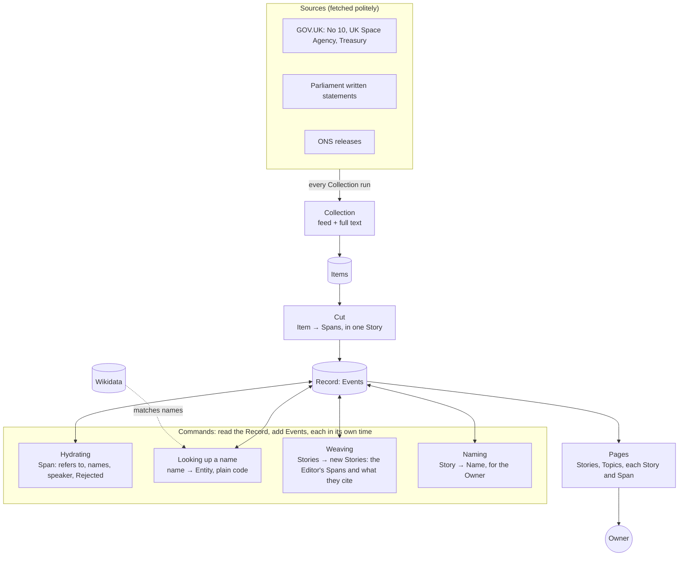

# go-slow

Slow news: it acts like the Economist, seeing the stories behind the stories and taking a zoomed-out view of the long-term causes.

The value is the editorial work: writing what no single source says, across sources and over time, and citing what it rests on. Collection from news sources is plumbing, done politely on its own timetable.

Go and htmx. This describes the design; the code still builds an earlier one until epic #294's slices land.

## How it flows

Collection brings in each new Item, and the Cut splits it into Spans and puts them in one Story. Hydrating and looking up names work on those Spans. Weaving reads Stories and writes new ones, in the Editor's own words, citing what they rest on. A Story never changes, and the Owner reads them newest first, or through a Topic. The terms are in [`CONTEXT.md`](CONTEXT.md); the reasons for this shape are in the [system design](docs/system-design/README.md).

