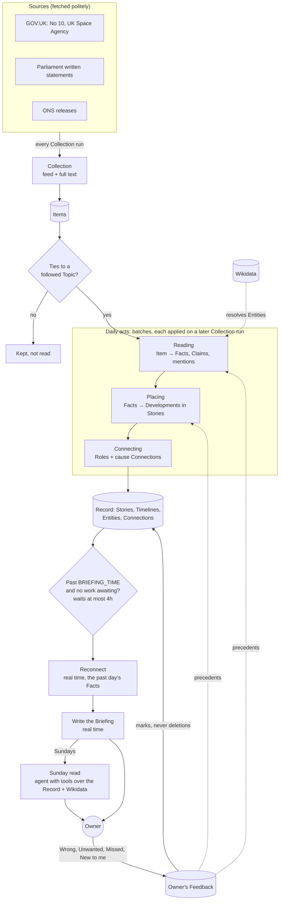

# go-slow

Slow news: a daily briefing, with a longer read on Sundays that puts the week into wider context.

The value is the editorial work: following how things unfold, linking across items, telling claims from facts against primary sources, and surfacing what a casual reader would miss. Collection from news sources is plumbing, done politely on its own timetable.

Early design. Go and htmx. The working concepts are in the issues.

## How it flows

Collection runs every few minutes. Reading, placing and connecting run in batches, each applied on a later Collection run, so the acts follow one another. The Briefing is written in real time once the morning's work is done. The terms are in [`CONTEXT.md`](CONTEXT.md); the reasons for this shape are in the [system design](docs/system-design/README.md).

